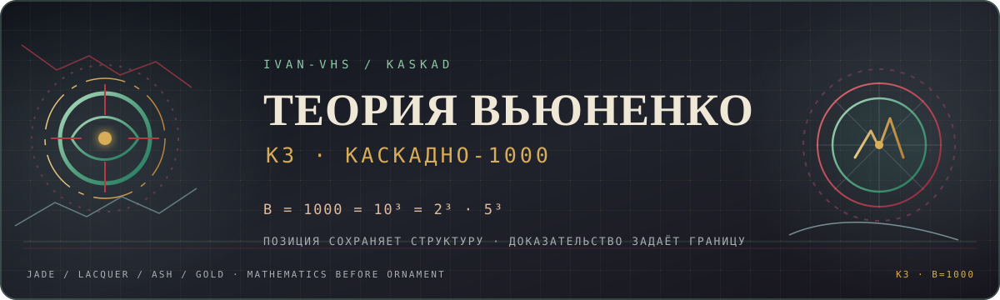

  
  
<strong>НЕФРИТОВЫЙ АТЛАС · ИССЛЕДОВАТЕЛЬСКАЯ ТЕОРИЯ K3</strong>

  
ТИПИЗИРОВАННЫЙ НУЛЬ · ПОЗИЦИОННАЯ СТРУКТУРА · АЛГЕБРАИЧЕСКИЙ ВЕРДИКТ

<a href="../README.md">ГЛАВНАЯ</a> · <a href="INDEX.md">КАРТА ДОКУМЕНТОВ</a> · <a href="VYUNENKO_THEORY.md">КАНОН K3</a> · <a href="CROSS_REPOSITORY_MATHEMATICAL_SYNTHESIS_K3X.md">K3-X</a>

---

# Теория Чумного Вердикта
## Типизированная теория нуля, целочисленной идентичности и каскадного вердикта

**Идентификатор:** TCV-K3  
**Краткое имя:** ТЧВ-K3  
**Версия:** 0.1.0  
**Статус:** исследовательская формальная спецификация; определения и приведённые элементарные теоремы доказаны в пределах явно заданных предпосылок  
**Базовая система:** Теория Вьюненко K3  
**Основание:** \(B=1000=2^3\cdot5^3\)  
**Совместимость:** аддитивное расширение; каноническая арифметика и синтаксис K3 не изменяются

---

## 0. Центральное положение

Теория Чумного Вердикта исследует не «новый нуль вместо классического нуля», а точные условия, при которых объект имеет нулевое значение, является нулевым элементом конкретной алгебраической структуры, сохраняет нулевую позицию в каскаде или получает нулевой вердикт на основании достоверных данных.

Её центральное положение:

> **Целое число не становится нулём из-за принадлежности к множеству целых чисел. Нулём является только нулевой элемент соответствующей структуры. Нуль принадлежит целым числам, но не отождествляется с произвольным целым числом, нулевой позицией, отсутствующим значением или неизвестным наблюдением.**

В обычном кольце целых чисел это положение имеет строгую форму:

\[
0\in\mathbb Z,\qquad \mathbb Z\ne\{0\},
\]

\[
\forall n\in\mathbb Z\setminus\{0\}:\quad n\ne0.
\]

Эти равенства сами по себе являются классическими фактами, а не новым открытием. Предмет ТЧВ-K3 — построить согласованную систему различения нуля и целого объекта на всех математических уровнях, уже присутствующих в Kaskad и его связанных проектах.

Теория опирается на четыре наблюдаемых в математическом корпусе Kaskad явления:

1. нулевая группа K3 не изменяет числовую оценку, но её позиция является частью структуры;
2. разные структурные выражения могут иметь одно и то же нулевое числовое значение;
3. кольца вычетов по степеням 1000 и \(1000\)-адическое пополнение содержат ненулевые делители нуля;
4. в прикладных числовых моделях нулевое значение, неизвестность, отсутствие данных, неопределённость и ошибка являются разными состояниями.

ТЧВ-K3 сохраняет классическую арифметику там, где она применима, и запрещает переносить её свойства между разными типами объектов без доказанного отображения.

## 1. Область объектов и типизированное равенство

### 1.1. Типизированный носитель

**Определение 1.1.** Типизированной математической областью назовём пару

\[
\mathcal A_\tau=(X_\tau,+_\tau,0_\tau),
\]

где:

- \(\tau\) — сигнатура типа;
- \(X_\tau\) — множество допустимых объектов данного типа;
- \(+_\tau\) — определённая внутри этого типа операция сложения;
- \(0_\tau\) — её нейтральный элемент, если такая структура существует.

В сигнатуру \(\tau\), в зависимости от предмета, могут входить:

- алгебраическая область и модуль;
- единица физической величины;
- основание и позиционный индекс;
- размерность вектора или массива;
- канал и частота дискретизации сигнала;
- тип целочисленного регистра и его диапазон;
- источник и статус наблюдения.

Не всякая область данных обязана иметь операцию сложения. Поэтому обозначение \(0_\tau\) допустимо только тогда, когда нулевой элемент математически определён.

### 1.2. Единственность нулевого элемента

**Определение 1.2.** Нулевым элементом области \(\mathcal A_\tau\) называется элемент \(0_\tau\in X_\tau\), удовлетворяющий

\[
x+_\tau0_\tau=0_\tau+_\tau x=x
\]

для каждого \(x\in X_\tau\), если область является аддитивным моноидом или группой.

**Теорема 1.1. Единственность нуля внутри одного носителя.**

В одной и той же аддитивной структуре существует не более одного нейтрального элемента.

**Доказательство.** Пусть \(e\) и \(f\) — два нейтральных элемента одной структуры. Из нейтральности \(e\) следует \(e+f=f\). Из нейтральности \(f\) следует \(e+f=e\). Следовательно, \(e=f\). \(\square\)

Отсюда следует важное ограничение: внутри одного и того же типа нельзя произвольно объявлять несколько разных аддитивных нулей. Различные нули допустимы у разных носителей, но их нельзя автоматически отождествлять.

### 1.3. Три отношения равенства

**Определение 1.3. Числовое равенство.**

Для объектов, имеющих отображение числовой оценки в общий носитель \(A\),

\[
x=_{\mathrm{val}}y
\iff
\nu(x)=\nu(y).
\]

Это отношение сравнивает значения, а не полную структуру.

**Определение 1.4. Структурное равенство.**

\[
x=_{\mathrm{str}}y
\]

тогда и только тогда, когда совпадают тип, упорядоченная позиционная структура, коэффициенты, размерность, значимые метаданные и те сведения о происхождении, которые входят в выбранную структурную сигнатуру.

**Определение 1.5. Типизированное равенство.**

\[
x=_\tau y
\]

разрешено только для объектов одного и того же носителя \(X_\tau\). Межтиповое сравнение требует явно определённого отображения или приведения типов.

В общем случае:

\[
x=_{\mathrm{str}}y\implies x=_{\mathrm{val}}y,
\]

но обратное утверждение неверно.

Равенство числовых оценок не восстанавливает ни исходную структуру, ни историю операций, ни источник наблюдения.

### 1.4. Формула «нуль равен целому числу, но не любому»

Для обычного целочисленного носителя:

\[
0_{\mathbb Z}\in\mathbb Z,
\]

\[
n=_{\mathbb Z}0_{\mathbb Z}
\iff n=0.
\]

Следовательно, нуль равен целому числу только тогда, когда рассматриваемый целочисленный объект действительно является нулём.

Для типизированных носителей запись

\[
0_\tau,\quad 0_\sigma,\quad \tau\ne\sigma
\]

обозначает нулевые элементы разных типов. Они имеют одинаковую числовую проекцию только при наличии общего числового отображения, но не становятся автоматически взаимозаменяемыми элементами.

Например, нулевая длина и нулевое время имеют одинаковое скалярное написание, но разные размерности. Подстановка одной величины вместо другой не является допустимым типизированным равенством.

## 2. Каскадная природа нуля K3

### 2.1. Канонический нуль

Пусть

\[
B=1000,\qquad D_B=\{0,1,\ldots,999\}.
\]

Для конечного вектора коэффициентов

\[
a=(a_0,a_1,\ldots,a_m),\qquad a_i\in D_B,
\]

значение задаётся отображением

\[
\operatorname{Val}_{K3}(a)=\sum_{i=0}^{m}a_iB^i.
\]

Каноническое представление неотрицательного целого числа имеет ненулевой старший коэффициент, если число положительно. Нуль имеет единственное каноническое представление:

\[
\boxed{\kappa_{1000}(0)=(0).}
\]

**Теорема 2.1. Единственность канонического нуля K3.**

Если канонический K3-вектор имеет значение ноль, он является одноэлементным нулевым вектором \((0)\).

**Доказательство.** Все коэффициенты неотрицательны, а все веса \(B^i\) строго положительны. Поэтому

\[
\sum_{i=0}^{m}a_iB^i=0
\]

возможно только при \(a_i=0\) для каждого \(i\). Если \(m>0\), старший коэффициент равен нулю, что запрещено условием каноничности положительного слова. Остаётся единственный одноэлементный вектор \((0)\). \(\square\)

Это положение полностью совместимо с постулатом K3-A5. ТЧВ-K3 не вводит альтернативную каноническую запись нуля.

### 2.2. Нулевой коэффициент и нулевое число — разные объекты

**Определение 2.1. Нулевая позиция K3.**

Нулевой позицией назовём структурный слот с индексом \(i\), коэффициент которого равен нулю:

\[
z_i=(i,0),\qquad i\in\mathbb N_0.
\]

Его числовой вклад равен

\[
\operatorname{contrib}(z_i)=0\cdot B^i=0.
\]

Однако индекс \(i\) входит в структурную сигнатуру позиции. Поэтому при \(i\ne j\):

\[
z_i\ne_{\mathrm{str}}z_j,
\qquad
\operatorname{contrib}(z_i)
=_{\mathrm{val}}
\operatorname{contrib}(z_j)=0.
\]

Иными словами, нулевой коэффициент на первой позиции и нулевой коэффициент на десятой позиции имеют одинаковый числовой вклад, но занимают разные места в каскаде.

**Следствие 2.1. Нулевое значение не разрешает удалять позицию.**

Если удаление нулевого коэффициента меняет индексы остальных коэффициентов, оно может изменить числовую оценку всего каскада.

Например:

\[
\begin{aligned}
\operatorname{Val}_{K3}(50k0k7)
&=50\cdot1000^2+0\cdot1000+7\\
&=50\,000\,007,
\end{aligned}
\]

тогда как после удаления внутренней нулевой позиции:

\[
\operatorname{Val}_{K3}(50k7)
=50\cdot1000+7
=50\,007.
\]

Таким образом, нулевой коэффициент может не вносить собственного числового вклада и одновременно быть критически важным для позиции остальных коэффициентов.

### 2.3. Нулевое значение при различной структуре

В K3-RAW структурный объект может сохранять явно записанную нулевую группу. Например:

\[
\operatorname{Eval}_{K3}(\operatorname{RawK3}(5k0))
=
5\cdot1000+0
=
5000,
\]

\[
\operatorname{Eval}_{K3}(5k)=5000.
\]

При этом:

\[
\operatorname{RawK3}(5k0)
\ne_{\mathrm{str}}5k,
\]

но

\[
\operatorname{RawK3}(5k0)
=_{\mathrm{val}}5k.
\]

Ещё один случай возникает при сокращении противоположных операндов:

\[
\operatorname{Eval}_{K3}(5k+(-5k))=0.
\]

Само дерево выражения

\[
\operatorname{AddExpr}(5k,-5k)
\]

не тождественно атомарному каноническому слову \(0\). Первое сохраняет два операнда и операцию, второе представляет только результат.

**Теорема 2.2. Нулевое числовое значение не определяет единственную структурную историю.**

Существуют разные структурные объекты с одинаковой нулевой числовой оценкой.

**Доказательство.** Сравним атомарный нулевой объект \(\operatorname{Atom}(0)\) и дерево \(\operatorname{AddExpr}(1,-1)\). Оценка первого равна нулю. По определению оценки дерева сумма второго также равна нулю. Их структурные типы различны: первый объект — атом, второй — узел операции с двумя операндами. Следовательно, они численно равны, но структурно различны. \(\square\)

## 3. Алгебраический вердикт: ноль зависит от носителя

### 3.1. Обычные целые числа

В кольце \(\mathbb Z\):

\[
ab=0\implies a=0\lor b=0.
\]

Поэтому произведение двух ненулевых обычных целых чисел не может равняться нулю.

Это свойство принадлежит именно \(\mathbb Z\) и не должно автоматически переноситься на другие кольца.

### 3.2. Конечное кольцо вычетов K3

Рассмотрим

\[
R_1=\mathbb Z/1000\mathbb Z.
\]

Положим

\[
e_2=625,\qquad e_5=376.
\]

В этом кольце:

\[
625\not\equiv0\pmod{1000},
\qquad
376\not\equiv0\pmod{1000},
\]

но

\[
625\cdot376=235000
\equiv0\pmod{1000}.
\]

Дополнительно выполняются:

\[
625^2\equiv625\pmod{1000},
\]

\[
376^2\equiv376\pmod{1000},
\]

\[
625+376\equiv1\pmod{1000}.
\]

Следовательно, это ненулевые ортогональные идемпотенты конечного кольца вычетов.

**Теорема 3.1. Ненулевые делители нуля на первом уровне K3.**

В \(R_1\) существуют ненулевые элементы \(e_2,e_5\), произведение которых равно нулю.

**Доказательство.** Числа 625 и 376 не кратны 1000, следовательно, их классы вычетов ненулевые. Их произведение равно 235000, которое делится на 1000. Поэтому произведение классов равно нулевому классу. \(\square\)

### 3.3. Бесконечное каскадное пополнение

Положим

\[
\widehat{\mathbb Z}_{1000}
=
\varprojlim_{r\ge1}\mathbb Z/1000^r\mathbb Z.
\]

Поскольку

\[
1000^r=2^{3r}5^{3r},
\]

китайская теорема об остатках даёт изоморфизм

\[
\widehat{\mathbb Z}_{1000}
\cong\mathbb Z_2\times\mathbb Z_5.
\]

В этой структуре проекторы имеют вид

\[
e_2\longleftrightarrow(1,0),
\qquad
e_5\longleftrightarrow(0,1).
\]

Они удовлетворяют:

\[
e_2\ne0,\qquad e_5\ne0,\qquad e_2e_5=0.
\]

**Следствие 3.1. Разделение ненулевого и нулевого статусов относительно алгебраической области.**

Ненулевые элементы могут иметь нулевое произведение в конечном кольце вычетов или в \(1000\)-адическом пополнении. Это не означает, что такие элементы являются нулевыми обычными целыми числами.

Вложение

\[
\iota:\mathbb Z\hookrightarrow\widehat{\mathbb Z}_{1000}
\]

инъективно, а образ обычных целых сохраняет отсутствие делителей нуля. Проекторы \((1,0)\) и \((0,1)\) не являются образами обычных целых чисел: обычное целое отображается в обе CRT-компоненты одним и тем же целым значением, тогда как эти проекторы задают разные компоненты.

Итак, необходимо сохранять три разных утверждения:

| Область | Что верно |
|---|---|
| \(\mathbb Z\) | Произведение ненулевых элементов ненулевое |
| \(\mathbb Z/1000^r\mathbb Z\) | Возможны ненулевые делители нуля |
| \(\widehat{\mathbb Z}_{1000}\) | Существуют ненулевые ортогональные идемпотенты с нулевым произведением |

Именно область определения решает, какое утверждение о нуле истинно.

## 4. Вердикт нуля и состояния данных

### 4.1. Зачем нужен отдельный вердикт

В связанных математических моделях встречаются поля, в которых значение может быть нулём, неизвестным, отсутствующим, неточным или недопустимым. Сведение всех этих случаев к числу 0 уничтожает информацию и приводит к ложным выводам.

ТЧВ-K3 вводит конечное множество вердиктов:

\[
\mathcal V=
\{
\mathbf Z,\mathbf N,\mathbf U,\mathbf A,\mathbf I
\},
\]

где:

- \(\mathbf Z\) — подтверждённое точное нулевое значение;
- \(\mathbf N\) — подтверждённое точное ненулевое значение;
- \(\mathbf U\) — значение неизвестно или недостаточно точно;
- \(\mathbf A\) — объект или поле отсутствует либо неприменим;
- \(\mathbf I\) — вход недопустим, нарушен контракт или операция завершилась ошибкой.

**Определение 4.1. Функция Чумного Вердикта.**

Для типизированного наблюдения \(x\) функция

\[
\operatorname{PV}_\tau(x)\in\mathcal V
\]

возвращает:

\[
\operatorname{PV}_\tau(x)=
\begin{cases}
\mathbf I,&\text{если объект нарушает тип или контракт},\\
\mathbf A,&\text{если объект или поле отсутствует},\\
\mathbf U,&\text{если точное значение не установлено},\\
\mathbf Z,&\text{если точное допустимое значение равно }0_\tau,\\
\mathbf N,&\text{если точное допустимое значение отлично от }0_\tau.
\end{cases}
\]

Порядок проверки является частью определения. Недопустимый объект нельзя объявлять нулём; отсутствующее поле нельзя интерпретировать как измеренное значение 0; неизвестное состояние нельзя автоматически заменять нулём.

### 4.2. Неопределённость измерения

Пусть измерение представлено гарантированным интервалом

\[
I=[l,u],\qquad l\le u.
\]

Для вопроса о точном нуле:

\[
\operatorname{PV}(I)=
\begin{cases}
\mathbf Z,&I=\{0\},\\
\mathbf N,&0\notin I,\\
\mathbf U,&0\in I\text{ и }I\ne\{0\}.
\end{cases}
\]

Например:

\[
[0,0]\mapsto\mathbf Z,
\]

\[
[2,3]\mapsto\mathbf N,
\]

\[
[-0.1,0.1]\mapsto\mathbf U.
\]

Последний интервал содержит ноль, но не доказывает, что истинная величина равна нулю. Это различие необходимо для корректной работы с погрешностями.

### 4.3. Вердикт не является дополнительной арифметической операцией

\(\operatorname{PV}\) классифицирует состояние свидетельства о значении. Он не заменяет сложение, умножение, деление, сравнение или нормализацию K3. Для вычисления по-прежнему используются соответствующие арифметические операции, а вердикт строится после проверки типа, допустимости и достоверности исходных данных.

## 5. Межрепозиторная математическая интеграция

ТЧВ-K3 собирает в единую систему уже заданные математические границы проектов. Это интеграция моделей и контрактов, а не утверждение о том, что каждый проект реализует функцию \(\operatorname{PV}\).

| Проект | Математический вклад в ТЧВ-K3 | Запрещённое отождествление |
|---|---|---|
| Kaskad / K3 | Позиционные коэффициенты, нулевые группы, структурное равенство, знаковые выражения, CRT | Нулевая группа не тождественна удалённой позиции |
| Reaper | Проверяемая целочисленная арифметика, ограниченные типы, явные ошибки переполнения и деления на ноль | Ошибка операции не является числовым нулём |
| Pytyliki | Размерностные модели, метрики, конечные множества возможностей, измерения и неопределённость | Неизвестная или неточная величина не является точным нулём |
| VentuSample | Дискретные сигналы, каналы, отсчёты, буферы и преобразование частоты дискретизации | Нулевой отсчёт не тождествен отсутствующему отсчёту или пустому буферу |
| OPlague | Источники свидетельств, точное совпадение идентификаторов, состояния недоступности телеметрии | Недоступная телеметрия не является измеренным нулём; кандидатное совпадение не является вердиктом безопасности |
| DAK | Состояния подсистем, ограничения ресурсов, возможности и границы реализации | Нулевая измеренная величина не тождественна отсутствующей или ещё не реализованной подсистеме |

### 5.1. Числовой тип Reaper

Для целочисленного регистра с проверяемым диапазоном ноль является допустимым значением, если он входит в диапазон типа. Переполнение и деление на ноль остаются ошибочными состояниями, а не способами получить нулевое значение.

Для знакового 64-битного типа:

\[
-2^{63}\le n\le2^{63}-1.
\]

Вердикт \(\mathbf Z\) допустим для корректного результата \(n=0\). Ошибочное вычисление не может быть автоматически преобразовано в \(\mathbf Z\).

### 5.2. Измерительные типы Pytyliki

Для величины с единицей измерения нулевой элемент сохраняет размерностный тип. Нулевая длина, нулевая длительность и нулевая масса не являются взаимозаменяемыми объектами.

При наличии интервала неопределённости применяется правило §4.2. Это исключает ложное утверждение о точном нуле на основании одного лишь попадания нуля в диапазон.

### 5.3. Дискретный сигнал VentuSample

Для сигнала можно задать тип

\[
\tau_{\mathrm{sig}}=(f_s,C,N),
\]

где \(f_s\) — частота дискретизации, \(C\) — число каналов, \(N\) — число отсчётов.

Нулевой сигнал известной формы — это массив допустимого размера, все элементы которого равны нулю. Пустой массив имеет \(N=0\) и не является тем же объектом, что массив из \(N>0\) нулевых отсчётов.

Следовательно:

\[
\operatorname{ZeroSignal}(f_s,C,N)
\ne_{\mathrm{str}}
\operatorname{EmptyBuffer}(f_s,C).
\]

Числовая тишина, отсутствие буфера и отсутствие наблюдения должны оставаться разными состояниями.

### 5.4. Свидетельство OPlague

Если источник телеметрии недоступен или значение не предоставлено, вердикт равен \(\mathbf U\), а не \(\mathbf Z\). Если устройство или поле отсутствует, применяется \(\mathbf A\). Совпадение нормализованных идентификаторов создаёт отношение-кандидат, но само по себе не удостоверяет безопасность или совместимость.

### 5.5. Состояния DAK

Нулевое измеренное число доступных ресурсов может получить \(\mathbf Z\). Но ещё не реализованная функция ядра, неизвестное состояние драйвера или отсутствующая конфигурация не превращаются вследствие этого в числовое значение ноль. Для каждого случая сначала определяется тип состояния и способ получения свидетельства.

## 6. Аксиоматическая система ТЧВ-K3

Теория фиксирует следующие правила как аксиомы своего формального слоя.

**А1. Локальность нуля.** Нулевой элемент определяется относительно конкретного аддитивного носителя.

**А2. Единственность.** В одном аддитивном носителе нейтральный элемент единственен.

**А3. Сохранение оценки.** Любое допустимое структурное преобразование, объявленное численно эквивалентным, обязано сохранять числовую оценку.

**А4. Сохранение позиции.** Нулевой коэффициент не удаляется из структурного каскада без доказательства сохранения индексов и значения остальных групп.

**А5. Неподмена свидетельств.** Неизвестное, отсутствующее, неопределённое и недопустимое состояния не преобразуются в нулевое значение без явного математического правила и доказательства.

**А6. Разделение алгебраических областей.** Свойства \(\mathbb Z\), конечных колец вычетов и \(1000\)-адического пополнения доказываются отдельно для соответствующей области.

**А7. Явное приведение типов.** Числовое сравнение разных типов допустимо только при наличии определённого общего отображения. Оно не создаёт типизированного равенства.

**А8. Доказательный вердикт.** Вердикт \(\mathbf Z\) требует достоверного точного нулевого значения; отсутствие свидетельства не является доказательством нуля.

Аксиомы А1–А8 являются правилами предлагаемого исследовательского слоя. Они не выдаются за новые независимые аксиомы всей классической математики.

## 7. Основные следствия

Из определений и теорем следуют:

1. В \(\mathbb Z\) существует единственный нулевой элемент, и ни одно ненулевое целое число не равно ему.
2. В каноническом конечном K3 существует единственная запись нуля \((0)\).
3. Нулевая группа в структурном каскаде может иметь нулевой числовой вклад, но её позиция остаётся значимой.
4. Нулевое числовое значение не определяет единственную историю вычисления.
5. В кольцах \(\mathbb Z/1000^r\mathbb Z\) и в \(1000\)-адическом пополнении возможны ненулевые делители нуля.
6. Нулевой элемент одного типа нельзя автоматически подставлять вместо нулевого элемента другого типа.
7. Неизвестные, отсутствующие и недопустимые состояния не являются числовым нулём.
8. Результат арифметической операции и доказательный статус этого результата должны храниться раздельно.

## 8. Что теория не утверждает

ТЧВ-K3 не утверждает, что:

- классическая теория целых чисел неверна;
- ноль перестаёт быть элементом \(\mathbb Z\);
- любой ненулевой элемент может стать нулём в любой алгебраической структуре;
- числовое значение можно менять без изменения формальной области;
- все структурные нули являются разными целыми числами;
- отсутствие данных доказывает отсутствие величины;
- конечная вычислительная проверка заменяет общее математическое доказательство;
- существование математической спецификации означает, что её программная реализация уже выполнена.

В частности, выражение «целое число не равно нулю» без условия \(n\ne0\) математически некорректно как универсальное утверждение о каждом элементе \(\mathbb Z\). Точная формулировка:

\[
\forall n\in\mathbb Z\setminus\{0\}: n\ne0.
\]

А выражение «нуль равен целому числу, но не любому» получает точную форму:

\[
0_{\mathbb Z}\in\mathbb Z,\qquad
n=0_{\mathbb Z}\iff n=0,
\]

с дополнительным типизированным ограничением для разных алгебраических носителей.

## 9. Доказательный статус и дальнейшая программа

| Результат | Статус |
|---|---|
| Единственность нейтрального элемента в аддитивной структуре | Доказанная теорема 1.1 |
| Единственность канонического нуля K3 | Доказанная теорема 2.1 |
| Различие числового и структурного равенства | Доказанная теорема 2.2 и определения |
| Ненулевые делители нуля в \(\mathbb Z/1000\mathbb Z\) | Доказанная теорема 3.1 |
| CRT-разложение пополнения | Классический результат, применённый в K3 |
| Пятизначная функция вердикта | Определение 4.1 |
| Межрепозиторная классификация нулевых и ненулевых состояний | Формальная интеграционная спецификация |
| Глобальная новизна теории в мировой математической литературе | Не установлена |

Следующие исследовательские задачи:

1. построить формальную систему вывода для пяти состояний вердикта;
2. определить композицию вердиктов для цепей арифметических и измерительных операторов;
3. доказать условия сохранения вердикта при K3-нормализации;
4. исследовать вердикт нулевого произведения в обратных пределах и CRT-компонентах;
5. разработать конечные контрпримерные наборы для ошибок смешения нуля, отсутствия и неизвестности;
6. построить машиночитаемую спецификацию и валидатор соответствия без изменения арифметического ядра K3.

Для каждого результата должны фиксироваться область определения, используемые определения, зависимости, доказательство, контрпример к чрезмерному обобщению и статус вычислительной проверки.

## 10. Источники внутри математического корпуса

Теория разработана как совместимый исследовательский слой на основе следующих проверяемых материалов:

- [Теория Вьюненко K3](VYUNENKO_THEORY.md) — канонический нуль, позиционные коэффициенты, знаковая арифметика и конечное основание.
- [Канонический синтаксис K3](K3_CANONICAL_SYNTAX.md) — формальные правила представления и нулевые группы.
- [Структурная семантика K3](K3_STRUCTURAL_SEMANTICS_AND_ORDERED_SUMS.md) — числовое и структурное равенство, K3-RAW и упорядоченные выражения.
- [CRT-идемпотенты и бесконечные каскады](K3_CRT_IDEMPOTENTS_AND_INFINITE_CASCADES.md) — \(e_2,e_5\), обратный предел и нулевые произведения.
- [Кросс-репозиторный синтез K3-X](CROSS_REPOSITORY_MATHEMATICAL_SYNTHESIS_K3X.md) — математическая связь Kaskad, Pytyliki, Reaper, VentuSample, OPlague и DAK.
- [Математическая основа Pytyliki](PYTYLIKI_TO_K3_MATHEMATICAL_FOUNDATION.md) — размерности, измерения, неопределённость и числовые контракты.
- [Математические основания OPlague](OPLAGUE_MATHEMATICAL_FOUNDATIONS.md) — свидетельства, неизвестные значения, графы кандидатов и ограничения данных.
- [Нативная арифметика Reaper](https://github.com/Ivan-VHS/Reaper/blob/main/docs/NATIVE_COMPILER.md) и [исполнение IR](https://github.com/Ivan-VHS/Reaper/blob/main/docs/NATIVE_IR_EXECUTION.md) — проверяемые числовые контракты и ошибки.
- [VentuSample](https://github.com/Ivan-VHS/VentuSample) — дискретные сигналы, каналы, буферы и преобразование частоты дискретизации.
- [DAK](https://github.com/Ivan-VHS/DAK) — типизированные состояния системных возможностей и границы реализации.

Межрепозиторный синтез использует математические модели и опубликованные контракты. Он не означает перенос исходного кода, автоматическое изменение зависимых проектов или подтверждение неосмотренных реализаций.

---

## Заключительное определение

**Теория Чумного Вердикта K3** — типизированная математическая система, в которой нулевой статус определяется относительно конкретного алгебраического носителя, числовая оценка отделяется от позиционной и операционной структуры, а вердикт нуля отделяется от неизвестности, отсутствия и недопустимости данных.

Её основной закон:

\[
\boxed{
\text{Нулевое значение}
\ne
\text{нулевая позиция}
\ne
\text{нулевой элемент любого типа}
\ne
\text{отсутствие значения}.
}
\]

При этом сохраняется классическая истина:

\[
\boxed{
0\in\mathbb Z,\qquad
\forall n\ne0:\ n\ne0,
}
\]

а каскадное расширение показывает, что в других алгебраических областях два ненулевых объекта могут иметь нулевое произведение.

**ТЧВ-K3 не отменяет ноль. Она устанавливает, когда именно ноль является нулём, к какому носителю он принадлежит и какой математический вердикт допустимо вынести.**

---

TCV-K3 · ТЕОРИЯ ЧУМНОГО ВЕРДИКТА · ВЕРСИЯ 0.1.0 · ИССЛЕДОВАТЕЛЬСКИЙ СЛОЙ KASKAD

